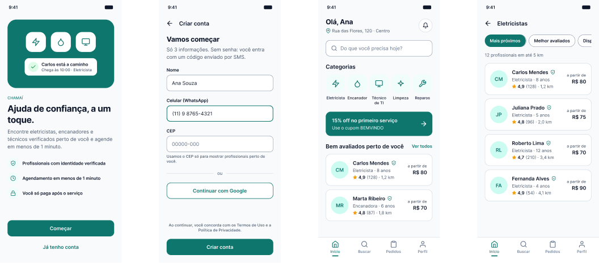
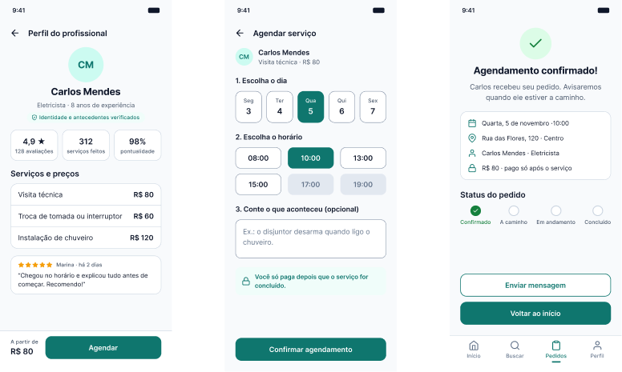
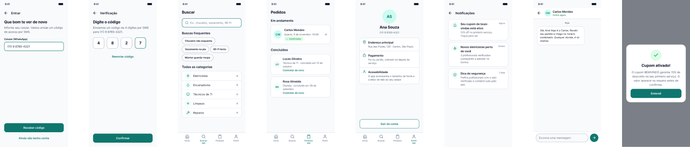
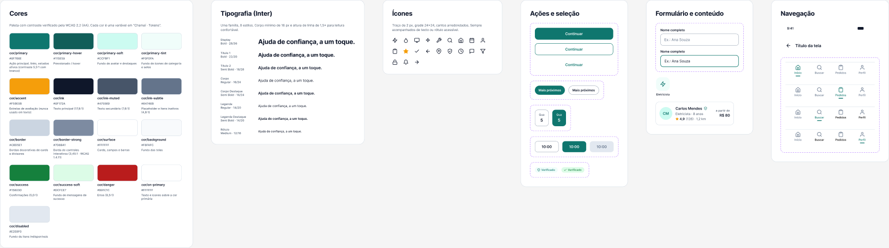

# Chamaí: ajuda de confiança, a um toque

Protótipo navegável de um app de serviços residenciais, feito no Figma para o trabalho **"Da Ideia à Experiência: Projetando e Prototipando uma Interface Digital com Figma"** (Design de Interação e Interface, UX/UI).

| | |
|---|---|
| **Arquivo no Figma** | https://www.figma.com/design/6urBb2iLUjp9Y3QCPD6vlR |
| **Protótipo navegável** | https://www.figma.com/proto/6urBb2iLUjp9Y3QCPD6vlR?node-id=2-4&starting-point-node-id=2%3A4 |
| **Documento teórico** | `Chamai - Parte Teorica (UX-UI).pdf` (e `.docx`) |
| **Vídeo pitch** | _cole aqui o link do YouTube (não listado), Loom ou Drive_ |
| **Autor** | Wendel Ferreira |

## Objetivo do produto

Contratar um eletricista, encanador ou técnico ainda depende de indicação, telefonemas e orçamento às cegas. O Chamaí deixa o morador **encontrar um profissional verificado perto de casa, ver o preço antes e agendar em menos de 1 minuto, pagando só depois do serviço**.

O redesenho ataca as três dores da versão anterior do produto:

| Dor | Causa | Solução no protótipo |
|---|---|---|
| Baixa adesão | Cadastro longo, com senha | 3 campos, login por código SMS ou Google |
| Abandono nas primeiras interações | Muitas categorias, nada claro na entrada | Busca em destaque e só 5 categorias |
| Dificuldade de uso | Sem preço, agendamento em várias telas | Preço visível, agendamento em uma tela e confirmação com status |

**Personas:** Ana (34 anos, sem tempo, usa o celular com uma mão) e Seu Antônio (67 anos, baixa visão, pouca familiaridade digital).

## Fluxo principal

```
01 Boas-vindas → 02 Cadastro → A2 Verificação por SMS → 03 Início → 04 Lista
→ 05 Perfil do profissional → 06 Agendamento → 07 Confirmação → (volta ao Início)
```

| Tela | O que o usuário faz | Interação no protótipo |
|---|---|---|
| 01 · Boas-vindas | Entende a proposta e as garantias | **Começar** → 02 · **Já tenho conta** → A1 |
| 02 · Cadastro | Nome, celular e CEP | **Criar conta** → A2 · **Continuar com Google** → 03 · Voltar |
| A2 · Verificação por SMS | Digita o código | **Confirmar** → 03 · **Reenviar código** mostra aviso · Voltar |
| 03 · Início | Escolhe a categoria | 5 categorias → lista de cada uma · busca → A3 · sino → A6 · banner → A8 · cards → 05 |
| 04 · Lista | Compara e filtra profissionais | 4 cards → 05 · filtros com seleção única · Voltar |
| 05 · Perfil | Confere avaliações e preços | **Agendar** → 06 · Voltar |
| 06 · Agendamento | Dia, horário e descrição | dia e horário com seleção única · **Confirmar agendamento** → 07 · Voltar |
| 07 · Confirmação | Vê o resumo e o status | **Enviar mensagem** → A7 · **Voltar ao início** → 03 |

### Telas complementares

| Tela | Função |
|---|---|
| A1 · Entrar | Acesso de quem já tem conta, só com o celular |
| A3 · Buscar | Busca por problema, buscas frequentes e todas as categorias |
| A4 · Pedidos | Pedido em andamento (abre a confirmação) e histórico com "Contratar de novo" |
| A5 · Meu perfil | Endereço, pagamento, acessibilidade e **Sair da conta** → 01 |
| A6 · Notificações | Cada aviso leva ao que anuncia |
| A7 · Conversa | Mensagens com o profissional; **Enviar** mostra a resposta da Ana |
| A8 · Cupom ativado | Janela sobreposta; fecha em **Entendi** ou tocando fora |

Além disso, a tela 04 existe para cada categoria: Eletricistas, Encanadores, Técnicos de TI, Limpeza e Reparos, com 4 profissionais em cada.

### Protótipo completo

- **134 elementos interativos:** todos os botões, cards, categorias, abas da navegação inferior, filtros e seletores levam a algum lugar.
- **Protótipo dinâmico com variáveis:** ao tocar em qualquer um dos 20 profissionais, perfil, agendamento, confirmação, pedidos e conversa passam a mostrar os dados dele (nome, profissão, nota, serviços e preços).
- **Seleção única** de dia, horário e filtro; o dia e o horário escolhidos aparecem na confirmação e em Pedidos.
- **Transições:** *slide* para a esquerda ao avançar, *dissolve* ao trocar de aba ou de contexto, ação "Voltar" nativa do Figma nas barras superiores.

## Decisões de design

**UX**
- **Lei de Hick:** poucas opções por tela (5 categorias, 3 filtros, 6 horários).
- **Lei de Fitts:** botões de 52 px, largura total, perto do polegar; CTA fixo no rodapé do perfil.
- **Lei de Jakob:** barra de navegação inferior com 4 abas, padrão já conhecido.
- **Heurísticas de Nielsen:** status visível (linha do tempo do pedido), prevenção de erros (horários indisponíveis bloqueados), reconhecimento em vez de memorização (resumo do profissional até o fim), consistência (design system único).
- **Confiança em primeiro lugar:** selo de verificação, nota com nº de avaliações, preço aberto e pagamento só após o serviço.

**UI**
- **Cor primária verde-petróleo `#0F766E`:** passa confiança e calma e se diferencia de bancos (azul) e delivery (laranja). Âmbar só nas estrelas.
- **Tipografia Inter:** feita para telas, ótima legibilidade; 8 estilos de 12 a 28 px, corpo com 16 px.
- **Grade de 4 px**, margens de 24 px, cantos de 12 a 16 px para um visual acolhedor.

**Acessibilidade (WCAG 2.2 AA)**
- Texto com contraste ≥ 4,5:1 (texto principal 17,85:1; branco sobre primária 5,47:1).
- Bordas de controles com 3,45:1 (token `border-strong`, WCAG 1.4.11).
- Nada depende só de cor: horário indisponível riscado, aba ativa com barra indicadora.
- Alvos de toque ≥ 44 px, rótulos sempre visíveis nos campos, linguagem simples.

## Organização do arquivo no Figma

| Página | Conteúdo |
|---|---|
| `00 · Capa` | Capa do projeto |
| `01 · Design System` | Cores (17 variáveis), espaçamentos e raios (8 variáveis), tipografia (8 estilos), 21 ícones e 11 componentes com variantes: Botão, Campo de texto, Chip de filtro, Seletor de dia, Horário, Selo, Categoria, Card profissional, Barra de status, Barra superior e Navegação inferior |
| `02 · Telas e Protótipo` | 19 telas de 390 × 844 px e uma sobreposição, em três fileiras: fluxo principal (`01` a `07`), telas complementares (`A1` a `A8`) e listas por categoria. Cada tela tem uma nota de decisão de UX acima e o fluxo inicial se chama "Fluxo principal · Agendar um serviço" |

Todas as telas são montadas com instâncias dos componentes, e as cores são variáveis: alterar um token ou componente atualiza o projeto inteiro. As 35 variáveis da coleção "Chamaí · Protótipo" guardam o profissional, o dia e o horário escolhidos durante a navegação.






## Como navegar no protótipo

1. Abra o link do protótipo (ou, no arquivo, a página `02 · Telas e Protótipo` → **Present** ▶).
2. O fluxo começa em **01 · Boas-vindas**. Toque nos botões destacados para avançar.
3. Pressione **R** para reiniciar o fluxo.
